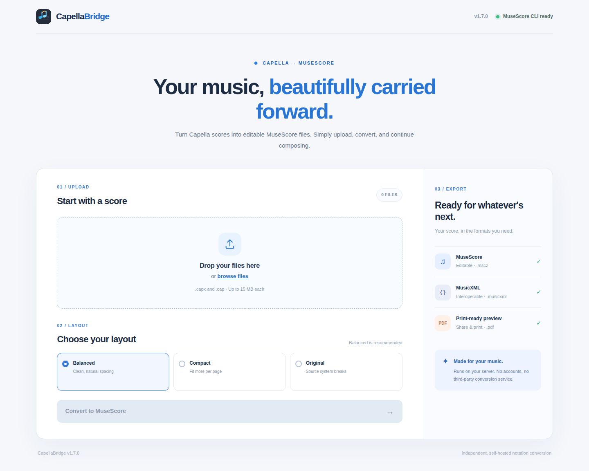
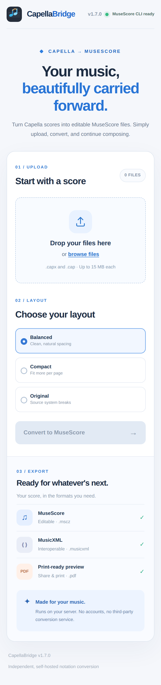

# CapellaBridge 🎼

**From Capella to MuseScore Studio — privately, on your own server.**

CapellaBridge converts `.capx` and legacy `.cap` music notation into editable MuseScore (`.mscz`) scores. It also exports MusicXML, PDF, a first-page PNG preview, and a conversion report. Designed to run on a Synology NAS as one Docker container with a browser interface.



<details><summary>Mobile interface</summary>



</details>

## Features

- **Native CapXML 2.0 parser** for `.capx`, preserving multiple staves, voices, musical pitches, rhythms, many slurs, articulations and repeat structures.
- **Legacy `.cap` support (best effort)** using MuseScore's legacy importer; accuracy depends on MuseScore support.
- **First-page credits** preserve prominent title, subtitle and composer as separate editable MusicXML credits when supplied in Capella.\n- **Editability-first engraving** with Balanced (recommended), Compact and Original Systems modes. Page layout may change, though spacing and staff structure are considered.
- **Multiple exports:** editable `.mscz`, `.musicxml`, `.pdf`, PNG preview, a JSON report, or all batch outputs in a ZIP.
- **Batch imports**, an upload progress percentage, a conversion activity indicator, warnings and downloadable reports.
- **Private processing**: no external API; source uploads deleted after conversion; results expire after 24 hours by default.
- **No application login:** Open the page and upload scores immediately; no users, passwords, or account settings.
- **GitHub Actions** tests, builds, smoke-tests the real converter inside Docker, and publishes to GitHub Container Registry (GHCR).

> This is an independent community tool, not affiliated with capella-software or MuseScore. MusicXML and MuseScore may reflow pages or not represent unusual Capella-specific drawn objects. Review the conversion report and final score.

## Quick start — pull an image on Synology

### 1. Publish the repository on GitHub

The project files live at the repository root, including the `.github/workflows/` directory. Push changes to `main` to build and publish automatically. GitHub Actions runs automatically when you push to `main`. A successful workflow publishes `ghcr.io/shuach613/capellabridge:latest`.

GitHub repository settings: **Actions → General → Workflow permissions** should allow the workflow's configured `packages: write` permission. `GITHUB_TOKEN` is supplied automatically; no manual Docker registry secret is needed. Under **Packages**, make the published package **Public** to allow your NAS to pull it without registry login. Private GHCR packages require `docker login` on the NAS.

### 2. Set up a minimal Compose stack on the NAS

Copy `docker-compose.yml` to `/volume1/docker/capellabridge/docker-compose.yml`, or paste it in Synology Container Manager → Project. The included Compose file already contains the correct image address. No environment file or other configuration is required.

```yaml
services:
  capellabridge:
    image: ghcr.io/shuach613/capellabridge:latest
    platform: linux/amd64
    pull_policy: always
    container_name: capellabridge
    restart: unless-stopped
    init: true
    ports:
      - "9595:8080"
    volumes:
      - capellabridge_data:/data
    security_opt:
      - no-new-privileges:true
    cap_drop:
      - ALL
    mem_limit: 2g

volumes:
  capellabridge_data:
```

From Synology SSH:

```bash
cd /volume1/docker/capellabridge
docker compose pull
docker compose up -d
```

Visit `http://NAS-IP:9595` from your network. No application login is required.

**Security:** Anyone who can reach this website can upload conversion jobs and use download links. Do not expose it publicly without access controls at your reverse proxy, or use a VPN for remote access. Upload limits are not a substitute for authentication.

### 3. Update the NAS after a GitHub push

```bash
cd /volume1/docker/capellabridge
docker compose pull
docker compose up -d
```

This **pulls** the GitHub-built image instead of compiling MuseScore on the NAS. To automate updates, configure a Synology DSM Task Scheduler task to run the same commands periodically. The included `scripts/nas-update.sh` provides an example.

## Push the code to GitHub from your computer

For an existing clone of this repository, run:

```bash
git add .
git commit -m "Update CapellaBridge"
git push origin main
```

Authenticate when Git asks (GitHub uses a credential manager or personal access token, not your account password). Or upload files in the GitHub web interface, ensuring `.github/workflows/` is included. Watch **Actions → Build and publish CapellaBridge**. The image only publishes after successful tests.

Optionally tag a release:

```bash
git tag v1.1.0
git push origin v1.1.0
```

## How conversion works

1. The browser uploads `.capx` or `.cap` to the container.
2. The CAPX parser reads score XML and maps musical structures to MusicXML; the legacy `.cap` path uses the MuseScore importer.
3. MuseScore runs **headlessly in the container**, saving an editable `.mscz` and PDF.
4. Poppler produces a PNG preview; the service generates a report listing warnings.
5. Results remain available for 24 hours, and then an automatic cleanup task removes them.

A single-process conversion queue reduces CPU spikes on smaller NAS devices. The container image currently targets **Linux x86-64 (`linux/amd64`)**. The web UI is responsive across desktop and mobile browsers.

## Operations and troubleshooting

| Task | Command |
| --- | --- |
| Check application logs | `docker logs capellabridge` |
| Check container status | `docker ps --filter name=capellabridge` |
| Check health | `curl http://127.0.0.1:9595/health` |
| Restart | `docker restart capellabridge` |
| Pull & redeploy | `docker compose pull && docker compose up -d` |
| Stop | `docker compose down` (preserves the volume) |

If image pulling fails, check the GHCR package visibility and exact lowercase image name. If the renderer is unavailable, inspect Docker logs and the `/health` endpoint. The `docs/screenshot.png` image is committed to this repository and displays directly on GitHub without an external image host.

## Project layout

```text
.github/workflows/       Unit tests, Docker build, smoke test, GHCR publication
app/main.py              API, cleanup, uploads, downloads
app/converter.py         CAPX → MusicXML converter
app/musescore.py         Headless MuseScore and previews
app/static/              Web interface
scripts/                 Smoke test and NAS updater
tests/                   Automated parser and API tests
docs/                    GitHub README screenshots
Dockerfile               Single-image build
docker-compose.yml       Ready-to-pull Synology stack
```

## Development

```bash
python -m pip install -r requirements.txt pytest httpx
python -m pytest -q
```

CI also builds the actual Docker image and runs a real score conversion through its HTTP API before publishing. Passing local unit tests does not establish that the headless MuseScore renderer works on every device. The workflow is the release gate.

## License

MIT. See [LICENSE](LICENSE).

## Feature branch: first-page credits and conversion progress

The web interface shows upload percentage and an animated activity indicator once the upload finishes. The conversion stage deliberately has **no fake percentage**, because the MuseScore CLI does not provide per-measure progress. First-page score credits are extracted from Capella text and exported as MusicXML title, subtitle and composer credits.

Finale's proprietary `.mus` and `.musx` files are not accepted directly; export MusicXML from Finale first. A future version can offer direct MusicXML and compressed `.mxl` imports.
